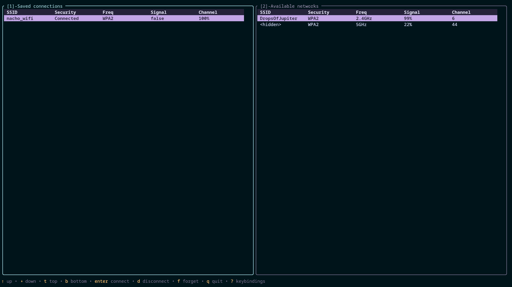
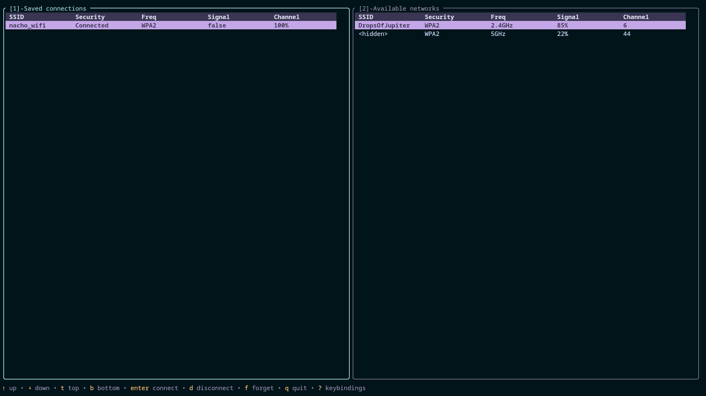
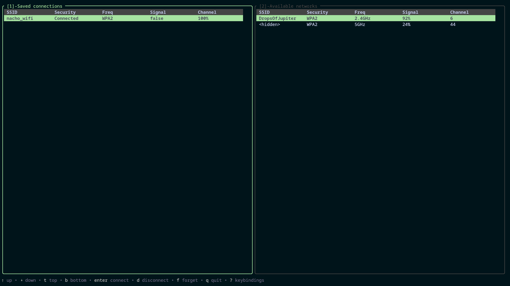

# Tuwi

A TUI for managing WiFi on Linux

<p>
    
</p>

## Screenshots

|             Rose Pine              |                Rose Pine Moon                |            Default             |
| :--------------------------------: | :------------------------------------------: | :----------------------------: |
|  |  |  |

## Features

- **Browse available networks** — scan and view nearby WiFi networks with signal strength, security type and frequency
- **Connect to networks** — connect to open, secured (WPA/WPA2/WPA3) and hidden networks
- **Manage saved connections** — view, connect to and forget saved WiFi profiles
- **Real-time updates** — network list updates automatically via NetworkManager D-Bus signals without manual scanning
- **Security detection** — accurately identifies WEP, WPA, WPA2, WPA3, WPA2/WPA3 transition, Enterprise and OWE networks
- **Keyboard driven** — fully navigable without a mouse

## Prerequisites

- A Linux based OS.
- NetworkManager running.

> [!INFO] Support for iwd backend has not been added yet.

## Installation

### Binary releases (recommended)

Download a binary from the Releases page [here](https://github.com/thecentinol/tuwi/releases)

### Build from source

- Make sure [Go](https://go.dev/doc/install) is installed.

```bash
git clone https://github.com/thecentinol/tuwi
cd tuwi
make install
```

`make install` installs the `tuwi` binary into `/usr/bin`. To install to a different location, edit the `PREFIX` and `BINDIR` variables in the [Makefile](https://github.com/thecentinol/tuwi/Makefile).

## Usage

Run:

```bash
tuwi
```

See the Configuration section for all keybinds.

## Configuration

The configuration path for the config file is `~/.config/tuwi/config.toml`.

### Default

This is purely a reference to all available config options and what the default values are. I do not
recommend you to copy-paste this into your config file as a whole.

```toml
# theming config for the main UI elements
[theme]
# you can select a preset, configure your own fully custom theme or modify a preset. you can also
# omit the preset to use the default theme. Available preset options are: rose-pine" and "rose-pine-moon".
# If you wish to use a fully custom theme you will need to set the preset to "custom".
preset = "default" # NOTE: you dont need to specify "default" to use the default theme
bg = ""
# text color
fg = "#c0c0c0"
border = "#444444"
border-focused = "#008800"
border-content = "#444444" # border content refers to the text seen in a border
border-content-focused = "#008800"
success = "#00ff00"

# theming config for tables, used to display saved and available Wi-Fi networks
[theme.table]
header-bg = "#444444"
header-fg = "#c0c0c0"
cell-bg = ""
cell-fg = ""
selected-bg = "#008800" # which row in the table is currently selected/active
selected-fg = "#000000"

# theming config for the error modal
[theme.error-modal]
text = "#800000"
border = "#008800"
border-content = "#800000"

# theming config for the password modal, seen when connecting to a new network
[theme.password-modal]
border = "#008800"
border-content = "#008800"

# theming config for an input area, i.e., the input area inside the password modal
[theme.input]
text-focused = "#c0c0c0"
text-muted = "#444444"
placeholder-focused = "#444444"
placeholder-muted = "#444444"
prompt-focused = "#444444"
prompt-muted = "#444444"
cursor = "#c0c0c0"

# theming config for the keybinds modal which shows you all available keybinds. The default keybind
# to open/show the modal is "?"
[theme.keybinds-modal]
border = "#008800"
border-content = "#008800"
group-text = "#008800"
keybinds-text = "#038B5A"
description-text = "#c0c0c0"

# theming config for the help view thats display at the bottom of the UI, it shows a short list of
# keybinds available for whichever component or modal you are currently active on/in
[theme.help-view]
ellipsis = ""
short-key = "#c0c0c0"
short-description = ""
short-separator = ""
full-key = ""
full-description = "#6e6a86"
full-separator = "#6e6a86"

# config for keybinds, these are again the default values. The keybinds will only work for the
# respective component/modal that is currently active/focused-on, meaning if you try to use the
# disconnect (default = "d") keybind while you are focused on the available wifi networks pane then
# it will not work - this is applicable to all keybinds. The help-view displayed at the bottom of
# the UI will show the main keybinds for whichever pane/modal/component you are currently focused on
[keybinds]
# connect to a saved network
connect-saved = ["enter"]
# disconnect from a saved network
disconnect = ["d"]
# forget a saved network
forget = ["f"]
# toggle the auto-connect state of a saved network on/off
auto-connect = ["a"]
# scan for nearby networks - refreshes the available wifi networks table
scan = ["s"]
# connect to a new available network
connect-available = ["enter"]
up = ["k", "up"]
down = ["j", "down"]
# move to the top of a table/scroll-area etc
go-to-top = ["t"]
# same as go-to-top
go-to-bottom = ["b"]
# dismiss the error modal
dismiss-error = ["esc", "enter"]
open-keybinds-modal = ["?"]
# when entering the password to connect to a new network this is used to show/hide the password
toggle-password-visibility = ["ctrl+t"]
# once you've entered your password, this keybind is used to submit it (in other words: to continue connecting)
submit-password = ["enter"]
# cancel is used to close modals and or cancel certain actions such as entering your password while
# connecting to a new network. If you set cancel to have only one keybind which is "c", for example,
# you can foresee that this wont work well during password input so either dont set it to a single
# letter or include more than one keybind options of which one is not a single letter
cancel = ["esc"]
# quit/close the entire app, this is a global keybind
quit = ["q", "ctrl+c"]
```

### Theming

As mentioned in the comments of the config file, you have the `default`, `rose-pine` and `rose-pine-moon`
presets to choose from. If you want to use the `default` theme then you dont need to specify `preset = "default"`,
nor do you even need a config file. Each preset can be modified (partially or fully), for example:

```toml
# here we modify the `rose-pine` theme to instead have red text with a yellow border and a pink focused border
[theme]
preset = "rose-pine"
fg = "#f40404"
border = "#f4dc04"
border-focused = "#f404d4"
```

If you wish to use a fully custom theme then set the preset to `preset = "custom"` and configure the
colors yourself using hex values.

## Uninstalling

Use this make command:

```bash
make uninstall
```

### Manually

You can manually remove the binary and config dir/file from `usr/bin` and `~/.config/tuwi`:

```bash
# if you changed the installation location of the binary, use that instead
rm -f /usr/bin/tuwi
rm -rf ~/.config/tuwi
```
